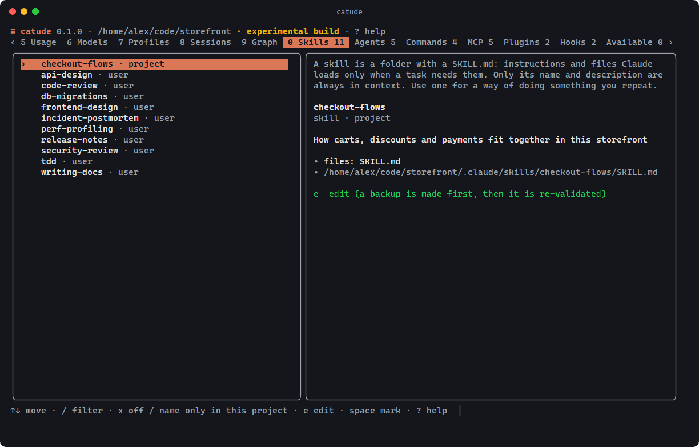
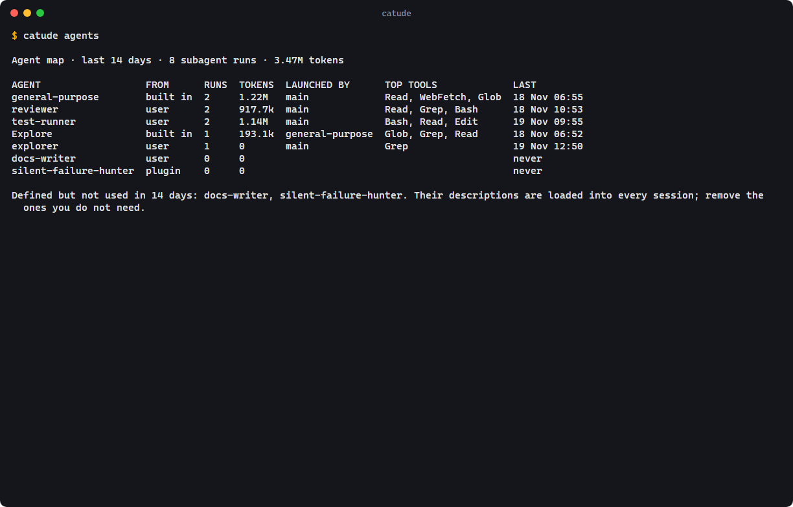

# The agent map



Every subagent Claude Code can use here (yours, the project's, plugins' and the built-in ones), joined with what
it really did in the last 30 days:

- how often it ran;
- who launched it: your conversation or another agent;
- the tools it used;
- the models;
- the tokens and an estimated cost at API list prices.

Agents you defined but never use are flagged, because their descriptions load into every session and cost
context for nothing.

## In the app

The **Agents** tab. `e` opens the agent's file in your editor (after a backup), `space` marks it for a new
[work profile](profiles.md), `r` reloads.

## From the command line

```sh
catude agents              # the last 30 days
catude agents --days 7
catude agents --json       # for scripts
```



## Why it matters for usage

Each subagent starts its own context and re-reads files, so a subagent that runs often can be a large part of
your usage. [`catude why`](why.md) shows the total; the agent map shows which ones and who starts them.
