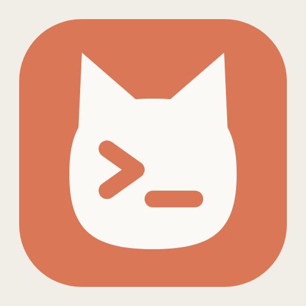
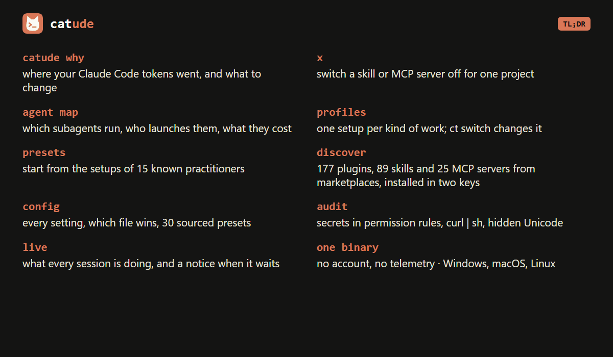
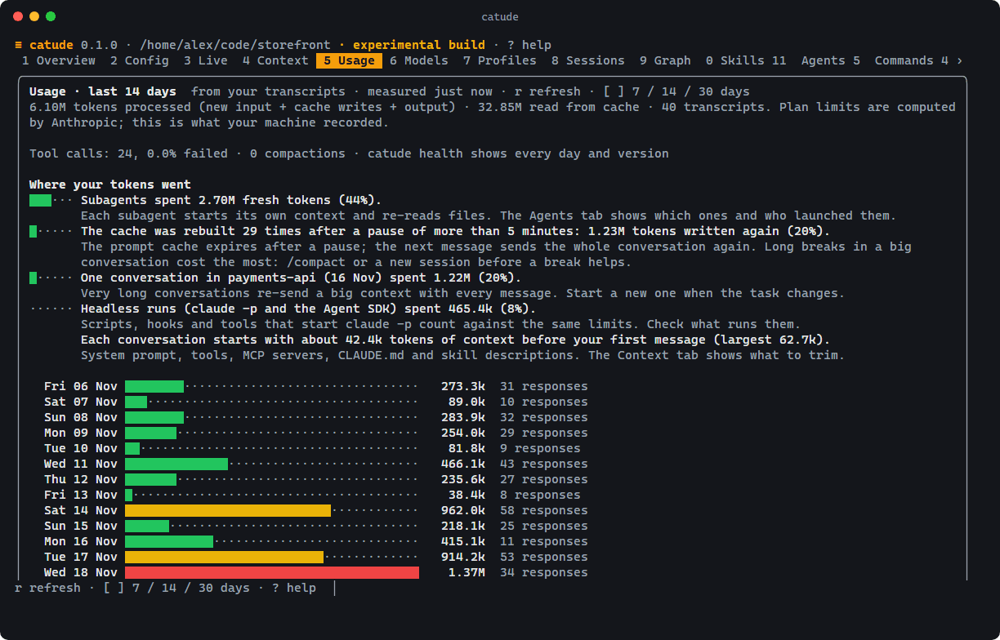

# catude

<div class="ct-hero" markdown>



<p class="ct-lead">Find out why your Claude Code usage runs out, trim what loads into every session, and see
everything that configures Claude Code and Claude Desktop on your machine.</p>

A terminal app and command line. One binary, no account, no telemetry. Windows, macOS, Linux and WSL.

[Install](install.md){ .md-button .md-button--primary } [Ask your AI about catude](ai.md){ .md-button }

</div>



!!! tip "TL;DR"
    - `catude why` tells you where your Claude Code tokens went: cache rebuilt after pauses, subagents,
      `claude -p`, the context before you type.
    - `x` switches a skill or MCP server off for one project, with the settings Claude Code documents.
    - The agent map shows which subagents run, who launches them and what they cost.
    - The audit finds secrets in permission rules, `curl | sh`, hidden Unicode and other risks in what you
      installed.
    - One binary, no account, no telemetry, reads local files only.

## What it answers

| Question | Where |
|---|---|
| **Why did my usage run out this week?** | [`catude why`](why.md), Usage tab |
| **What loads into every session before I type, and how do I trim it for one project?** | [Context, MCP and Skills tabs](trim.md) |
| **Which subagents run, who launches them and what do they cost?** | [Agents tab, `catude agents`](agents.md) |
| **Did something get worse after an update?** | [`catude health`](why.md#your-own-evidence-when-something-feels-worse) |
| **Is anything I installed unsafe?** | [Audit tab, `catude audit`](security.md#audit-rules) |
| **What is each running session doing right now?** | [Live tab](live.md) |
| **How do I keep one setup per kind of work?** | [Work profiles](profiles.md) |
| **Which file wins when a setting is in three places?** | [Config tab](config.md#effective-settings) |
| **Which `CLAUDE.md` and `AGENTS.md` files does Claude Code read here?** | [`catude instructions`](instructions.md) |
| **Which model and effort level should I use for this work?** | [Models tab, `catude models`](models.md) |

Everything comes from files already on your machine: Claude Code's transcripts and settings, and Claude
Desktop's configuration. catude changes nothing unless you press a key that does, backs up every file first,
and never shows or exports a secret.

## Install in one line

=== "Windows (PowerShell)"

    ```powershell
    irm https://raw.githubusercontent.com/catude/catude/main/scripts/install.ps1 | iex
    ```

=== "Linux, macOS, WSL"

    ```sh
    curl -fsSL https://raw.githubusercontent.com/catude/catude/main/scripts/install.sh | sh
    ```

=== "Go 1.24 or later"

    ```sh
    go install github.com/catude/catude/cmd/catude@latest
    ```

Then:

```sh
catude why      # where your tokens went
catude          # the terminal app (or the short: ct)
```

More options, updates and uninstalling: [Install](install.md).



## Everything it does

<div class="grid cards" markdown>

- **[Why your usage runs out](why.md)**: cache rebuilt after pauses, subagents, headless `claude -p` runs,
  the start-up context, the most expensive conversations, and whether a new Claude Code version uses more.
- **[Trim what loads into every session](trim.md)**: switch a skill or MCP server off for one project
  with `x`, using documented settings. Nothing is uninstalled.
- **[The agent map](agents.md)**: every subagent with its runs, who launched it, tools, models, tokens and
  an estimated cost. Unused agents are flagged.
- **[Health over time](why.md#your-own-evidence-when-something-feels-worse)**: tool calls, failures, API
  retries, compactions, cache hit and tokens per response, by day and Claude Code version.
- **[Audit](security.md#audit-rules)**: 25 rules for secrets, `curl | sh`, prompt injection, hidden
  Unicode, unpinned `npx`, risky permissions. Exit code 1 on high findings, so it fits in CI.
- **[Live sessions](live.md)**: every running Claude Code session as a card updated every second, and a
  notice when a session finishes.
- **[Work profiles](profiles.md)**: one set of skills, agents, commands, MCP servers and plugins per kind of
  work, plus [15 presets](presets.md) based on what practitioners published.
- **[Every setting, and which one wins](config.md)**: more than 300 settings and 400 environment variables,
  the effective value per project, and 30 configuration presets that quote their source.
- **[Sessions](usage.md#tabs)**: every conversation with its exact context, an estimated cost, a summary
  without AI, search, resume and export.
- **[Models](models.md)**: which Claude model and effort level is stronger for a kind of work, on public
  benchmarks, with cost per task.
- **[Discover](catalog.md)**: a curated catalog of plugins, skills, marketplaces and MCP servers, installed
  only through the official `claude plugin` and `claude mcp` commands.
- **[Graph](graph.md)**: apps, config files, instructions, skills, hooks, MCP servers and the processes they
  start, as a tree or a diagram.
- **[Instructions](instructions.md)**: which `CLAUDE.md`, `CLAUDE.local.md` and `AGENTS.md` files Claude
  Code reads, and a fix for the ones it silently skips.
- **[Storage](storage.md)**: sizes of transcripts, caches and Claude Desktop data, safe cleaning, and a
  warning before Claude Code deletes old transcripts.
- **[Export and import](rigcard.md)**: your setup in one file without secrets; imports are shown and audited
  first.
- **[Inside Claude Code](install.md#inside-claude-code)**: `/catude:doctor`, `/catude:audit`,
  `/catude:sessions`, `/catude:models`.
- **[10 languages and any terminal](accessibility.md)**: themes including high contrast, reduced motion,
  safe glyphs and a lite view.

</div>

## Let your AI explain it

These docs are written to be read by AI assistants too. Every page has a **Copy page as Markdown** and an
**Ask Claude about this page** button, and the whole site is available as
[`llms.txt`](https://catude.github.io/catude/llms.txt) and
[`llms-full.txt`](https://catude.github.io/catude/llms-full.txt). See [Ask your AI about catude](ai.md).

---

catude is an independent open-source project (MIT), not affiliated with or endorsed by Anthropic.
[Source on GitHub](https://github.com/catude/catude) ·
[Releases](https://github.com/catude/catude/releases) ·
[Report a vulnerability](../SECURITY.md)
