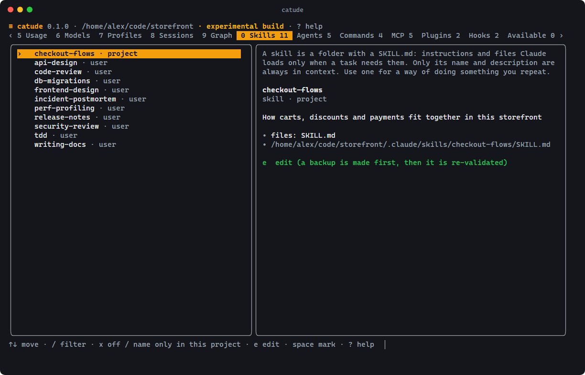

# Trim what loads into every session



Every Claude Code session starts with a system prompt, tool definitions, MCP servers, `CLAUDE.md` files and
the descriptions of your skills and agents, before you type anything. On a busy machine that can be a large
share of the window, and it is paid again in every session.

## See what fills the window

The **Context** tab asks Claude Code itself (`claude /context`) what fills the window at the start of a session
in this folder, and lists the biggest consumers you control: MCP servers, skills, agents, memory files. The
measurement runs in the background and is cached. From the command line:

```sh
catude context            # this folder
catude context ../other   # another project
catude context --json
```

How the numbers are measured: [How context is measured](context.md).

## Switch something off for this project

Select an item in the **Context**, **MCP** or **Skills** tab and press `x`:

| Item | What `x` does | Setting catude writes |
|---|---|---|
| MCP server from your user or local config | off in this project | `disabledMcpServers` |
| MCP server from the project's `.mcp.json` | off in this project | `disabledMcpjsonServers` |
| Skill | cycles *name only*, *only when you type /name*, *off* | `skillOverrides` |

These are the settings Claude Code documents for this. Nothing is uninstalled, the change applies only to this
project, and `x` again turns it back on. catude backs the settings file up first and keeps the rest of the file
untouched.

## Compare with a work profile

In the Context tab, `p` compares the current context with a [work profile](profiles.md): useful to see how
much a lighter setup for this kind of work would save before you switch to it.

## Tips

- Skills marked *manual only* (`disable-model-invocation`) cost no context: they load only when you type them.
- Agents you defined but never use still load their descriptions. The [agent map](agents.md) flags them.
- An MCP server with many tools is often the biggest single item. Switch it off where you do not need it.
