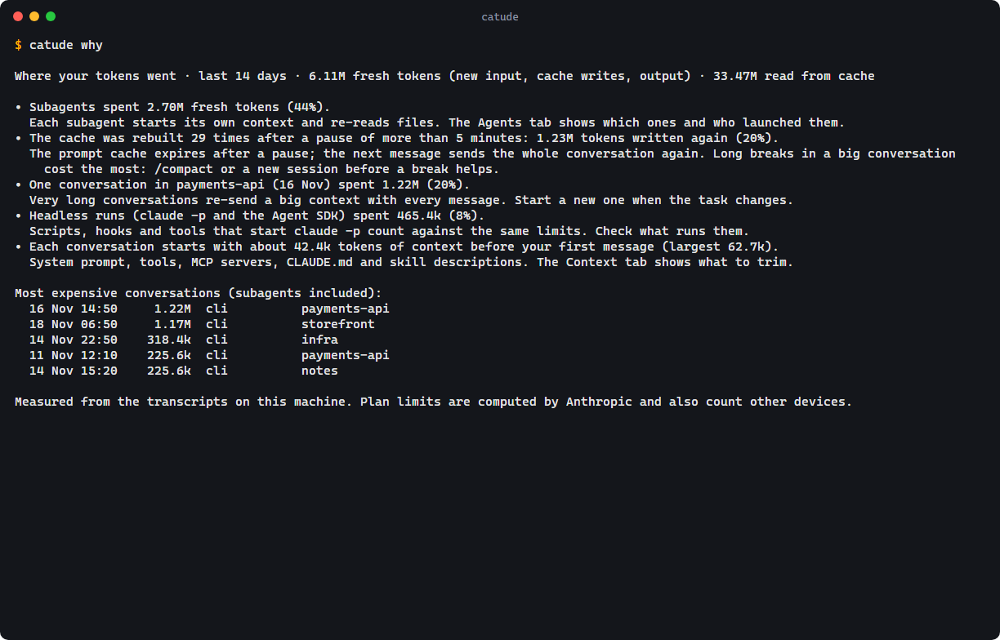
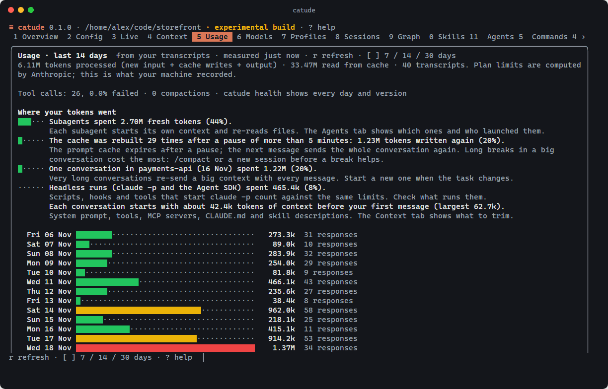
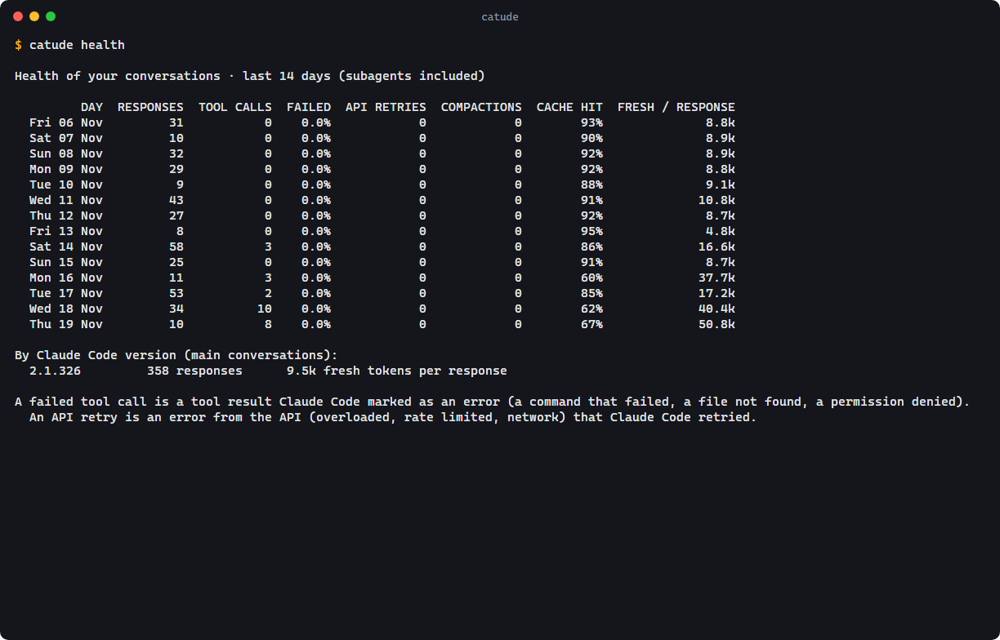

# Why your usage runs out



Counting tokens says *how much*. `catude why` says *where they went*, from the API usage Claude Code records in
your transcripts, and what to change.

```sh
catude why              # the last 30 days
catude why --days 7     # a shorter window
```

## What it looks for

| Cause | What happens | What to do |
|---|---|---|
| **Cache rebuilt after a pause** | The prompt cache expires after a few minutes without activity; the next message sends the whole conversation again. catude counts those rebuilds and what they cost | Start a new conversation instead of resuming a long one after a break, or `/compact` first |
| **Subagents** | Each one starts its own context and re-reads files | See which ones run and who launches them in the [agent map](agents.md) |
| **Headless runs** | Scripts, hooks and tools that start `claude -p` count against the same limits | Find them in the report; move them to a cheaper model or run them less often |
| **The context before your first message** | System prompt, tools, MCP servers, `CLAUDE.md` and skill descriptions load into every session | [Trim it per project](trim.md) |
| **The most expensive conversations** | A few long conversations often dominate | Open them in the Sessions tab |
| **A new Claude Code version** | Whether it uses more tokens per response than the previous one | Compare with [`catude health`](#your-own-evidence-when-something-feels-worse) |

A conversation resumed or forked into another folder copies its history; catude counts those responses once.

## The Usage tab

The **Usage** tab shows the same next to your days, models and projects (`[` and `]` change the window: 7, 14
or 30 days). With [claude-swap](https://github.com/realiti4/claude-swap) installed, it also shows when each plan
window resets and whether your pace lasts until then.



!!! info "Are these the same numbers as my plan limits?"
    No. Plan limits are computed by Anthropic and also count your other devices and claude.ai. catude shows
    what this machine recorded, which is what you can act on. Costs are estimates at API list prices and are
    labelled as such.

## Your own evidence when something feels worse



```sh
catude health             # the last 30 days
catude health --days 14
```

`catude health` shows, day by day and per Claude Code version:

- tool calls and how many failed;
- API errors Claude Code retried;
- compactions;
- the share of input read from the cache;
- fresh tokens per response.

When a session feels worse after an update, this is what changed on your machine, in numbers you can paste
into a bug report.
